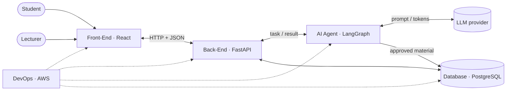
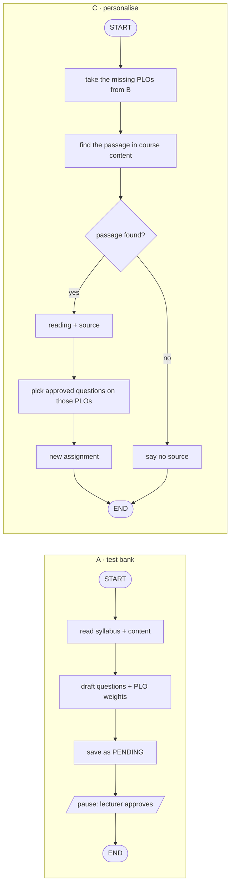

# Session 03 — Exercises: from the 5-block map to the first skeletons of MT-01

**Exercise book** · companion to the slide deck [`buoi-03.html`](buoi-03.html) (exercise slides `#ex1-brief` … `#ex4-steps`) and the lecture note [`buoi-3_lecture_note.md`](buoi-3_lecture_note.md) · course: *Mentoring for AI-aided Projects* · The Odyssey

> **How to use this file.** The slides carry the short version of each exercise. This file carries the full version.
> Every exercise has the same parts, in the same order as its two slides:
>
> | Slide 1 — the brief | Slide 2 — the steps |
> |---|---|
> | **Task** — the problem, the requirements, what goes in and what must come out | **Main steps** — high-level, each with an AI-aided method (a prompt, plan mode, a skill) and, for the first steps, the **manual** way |
> | **Input & tools** — knowledge, tools, files | **Manual — no AI** — sensitive or security steps a person must do |
> | **Expected output** — the files, with a figure or table of what is in them | **Keywords** — terms to look up for self-study |
>
> Each exercise ends with a **Done when** check you run yourself.
> Shell commands are written for **Git Bash** (the repo's default shell on Windows).

---

## Contents

| # | Exercise | After slides | Today | Continues in |
|---|----------|--------------|-------|--------------|
| 0 | [Before you start — the rules of the game](#0--before-you-start--the-rules-of-the-game) | — | read | — |
| 1.1 | [5-block map and stack](#exercise-11--5-block-map-and-stack) | 3 – 8 | steps 1 – 6 | every later exercise |
| 1.2 | [Front-end pages and APIs](#exercise-12--front-end-pages-and-apis) | 12 – 15 | steps 1 – 3 | buổi 4: steps 4 – 8 |
| 1.3 | [Back-end components and APIs](#exercise-13--back-end-components-and-apis) | 18 – 21 | steps 1 – 3 | buổi 4: steps 4 – 7 · DevOps: step 8 |
| 1.4 | [Agent job, rules and flow](#exercise-14--agent-job-rules-and-flow) | 27 – 29 | steps 1 – 2 | next chapter: steps 3 – 8 |
| A | [Appendix — self-learning prompts](#appendix--self-learning-prompts-with-claude-code) | — | any time | — |

Exercise slides in the deck: Ex 1.1 = slides 9 – 10 · Ex 1.2 = 16 – 17 · Ex 1.3 = 22 – 23 · Ex 1.4 = 30 – 31.

---

## 0 · Before you start — the rules of the game

### 0.1 One project, four exercises

Every exercise produces a file the next one reads. Nothing is a throw-away drill.

```
docs/de-bai.md ──► Ex 1.1  docs/systems/ARCHITECTURE_5BLOCK.md      (5 blocks + a technology each)
                     │
                     ├──► Ex 1.2  SPEC.md · UX.md · FE_PLAN.md + src/app …   (pages, components, API list)
                     │            │
                     │            └──► Ex 1.3  API.md · BACKEND_PLAN.md · tasks.json + src/api …  (endpoints, contract, auth)
                     │                        │
                     └────────────────────────┴──► Ex 1.4  AGENT.md · LANGGRAPH_NOTES.md + src/agent/  (job, rules, flow)
                                                          │
                                                          └──► buổi 4: build, wire, test
```

**Rule:** the first lines of every document you write in `docs/systems/` say which earlier files it is based on.

### 0.2 Who decides what

The repo's agent rules ([`.agents/rules/hoc-cung-ai.md`](../../../.agents/rules/hoc-cung-ai.md)) apply to these exercises:

| Claude does | **You** do |
|---|---|
| reads files, drafts documents, proposes options, scaffolds boilerplate | choose users, scope, framework, thresholds, what to keep or drop |
| explains terms, finds and summarises docs (with links) | open at least one link and check the summary is right |
| suggests a check | **run the check yourself** — "Claude said it works" is not a check |

If Claude in this repo answers "which do you prefer?" or "what did the `ERROR` line say?", that is the rules working, not Claude being unhelpful.

### 0.3 Four Claude Code ideas you need today

| Idea | What it is | Where it lives | When it acts |
|---|---|---|---|
| **CLAUDE.md** | Project memory: conventions, commands, rules. *Advice.* | repo root; a folder can have its own (`src/agent/CLAUDE.md`) | loaded at the start of every session (folder ones when Claude works there) |
| **Plan mode** | Claude reads and proposes, but **does not edit** until you approve | `Shift+Tab` until the status line shows plan mode | while you design |
| **Skill** | A reusable "how we do X here" package: instructions, optionally scripts and templates | `.claude/skills/<name>/SKILL.md` | **loaded when relevant** — Claude matches your request against the skill's `description`; you can also call it as `/<name>` |
| **Hook** | A shell command the Claude Code harness runs on an event (`PreToolUse`, `PostToolUse`, `UserPromptSubmit`, `Stop`, …) | `.claude/settings.json` (view with `/hooks`) | **always**, every time the event fires — Claude cannot "forget" it |

Rule of thumb: *if it is a preference, put it in CLAUDE.md; if it is know-how for one kind of task, make it a skill; if it must never be broken, make it a hook.*

> **This repo already has hooks.** `.claude/settings.json` runs `scripts/log_hook.py` on `UserPromptSubmit`, `PostToolUse` and `Stop` to log AI usage, and a separate **Git** pre-push hook ships the log. Do **not** call `scripts/log_*` by hand ([`.agents/rules/ai-log-hook.md`](../../../.agents/rules/ai-log-hook.md)). When you add a hook, **add** to the `hooks` object — never replace it.

### 0.4 Where the exercises sit — the software development life cycle (SDLC)

Slide 8 of the deck shows the six steps every software project walks through. **All exercises in this chapter (1.1 – 1.4) are about steps 1, 2 and 3** — nobody tests or deploys today.

| # | SDLC step | What happens | In this chapter |
|---|---|---|---|
| 1 | **Planning / Requirement** | Write down the business — the **Business Flow** file. You need it before you can tell the AI what you want. | `docs/de-bai.md`, the 5-block map, the agent's job and rules (Ex 1.1, 1.4) |
| 2 | **Design** | Draw the interface + dummy data, to see what the project will look like. | pages, UX and the API list (Ex 1.2, 1.3) |
| 3 | **Code** | Choose the tech stack, set up skills, put `CLAUDE.md` in. | step 1 of each exercise: project memory, skills, hooks, skeletons |
| 4 | Testing | Test all the code, security and performance — no testing, no production. | later chapters |
| 5 | Deploy | Move to the real environment. Usually buy a **VPS**; serverless only for a small landing page or a personal project. | later chapters (DevOps) |
| 6 | Maintain | Monitor the running application and fix bugs. | later chapters |

Each document you write in `docs/systems/` is a step 1 – 3 artifact; steps 4 – 6 need a running system, which comes after these skeletons exist.

---

## Exercise 1.1 · 5-block map and stack

**Slides:** `#ex1-brief`, `#ex1-claude` (9 – 10) · **Theory:** slides 3 – 8 · **Time:** 40 – 60 min

### Task

Read [`docs/de-bai.md`](../../de-bai.md) and design MT-01 as the five blocks of slide 3 — overview only, no endpoints, tables or code:

- the **general function** of each block (Front-End, Back-End, AI Agent, Database, DevOps);
- what **flows** between blocks, and where the **two roles** (student, lecturer) enter;
- a **technology** for each block, with a short **reason taken from `de-bai.md`** (an application requirement or a scope limit).

### Input & tools

| | |
|---|---|
| **Knowledge** | 5-block architecture (slides 3 – 8) · client–server · roles and permissions |
| **Tools** | Claude Code — plan mode, CLAUDE.md, skills, hooks · Mermaid for the diagram |
| **Files** | `docs/de-bai.md` — *Ba năng lực*, *Hai vai và ranh giới quyền*, *Yêu cầu đầu ra*, *Phạm vi cố tình loại khỏi đề* · `docs/architecture_diagram.md` (template picture) |

### Expected output — `docs/systems/ARCHITECTURE_5BLOCK.md`

Two parts: a **block diagram** and a **table** — block · general function · potential technology · reason from `de-bai.md`. The stack this course uses is shown below as the *potential* answer; the team may choose differently, as long as each reason points to `de-bai.md`.

| Block | General function | Potential technology | Reason (from `de-bai.md`) |
|---|---|---|---|
| Front-End | pages per role: assignment, PLO result, test-bank review | **React** | 2-role login (*Hai vai…*); web app usable at 360 px (*Yêu cầu đầu ra*); scalable and production-ready (slide 13) |
| Back-End | checks the role, applies the rules, calls the agent | **FastAPI** | friendly language — Python, like the agent; `async` / `await` serves many requests at once; the server must refuse "approve" from the student → 403 (*Hai vai…*, *Acceptance demo*) |
| AI Agent | drafts the test bank with PLO weights; suggests the part to read for a missing PLO | **LangGraph** | several steps — read, draft, find, cite — and a pause until the lecturer approves (*A · Ngân hàng câu hỏi gắn PLO*, *C · Cá nhân hoá*) |
| Database | users, courses, questions + PLO weights, submissions, PLO results; optional cache + job queue (Redis / SQS) — only if needed | **PostgreSQL** | free; linked records and a `PENDING` status; no paid vector DB (*Phạm vi*) |
| DevOps | build, test, deploy, monitor | **AWS** | professional and reliable cloud for "Web app deploy công khai" (*Yêu cầu đầu ra*) |

> **Open decision.** `de-bai.md`, *Phạm vi cố tình loại khỏi đề*, says "Streamlit trước, đẹp sau" for the basic version. React now or later is the **team's** decision — write it under *Open decisions* (and, if React, in `ADR-001-frontend.md` in Exercise 1.2).

*Shape of the file (fill in your own words):*

````markdown
# MT-01 — 5-block architecture (overview)
Based on: docs/de-bai.md · slides 3–8 of buoi-03.html

## Block diagram


## Blocks
| Block | General function | Technology | Reason (de-bai.md section) |
|---|---|---|---|
| Front-End | … | … | … |
| Back-End | … | … | … |
| AI Agent | … | … | … |
| Database | … | … | … |
| DevOps | … | … | … |

## Open decisions (team to decide)
- Streamlit first or React now? (de-bai.md "Phạm vi cố tình loại khỏi đề")
- …
````

### Main steps

The repo, the team and `git clone` were set up in buổi 01 — run `git pull` and start from step 1.

| # | Step | AI-aided — Claude Code | Manual way |
|---|---|---|---|
| 1 | **Start + project memory** (once per repo) | `claude` · `/model` · `/init` drafts or updates CLAUDE.md → record the project's main information (prompt a, below) · set up the important skills and hooks — recommended skills: **`tech-matching`**, **`learn-by-keywords`** (create them with the prompts in section B) | write CLAUDE.md yourself |
| 2 | **Read the brief** | prompt b | read `de-bai.md` with a pen: underline every role, every must / must not, every status (`PENDING`), every number (403, 360 px, 45 cases) |
| 3 | **Draw the diagram** — plan mode `Shift+Tab` | prompt c | draw the five boxes on paper, one sentence inside each, label every arrow |
| 4 | **Propose technologies** — the **`tech-matching`** skill | prompt d — the skill finds the top 3 technologies per block, then interviews you; **you** choose | list 2 options per block, tick the one each `de-bai.md` line supports |
| 5 | **Check against `de-bai.md`** | prompt e — a plain prompt, no skill: rule · section · where in the file · OK / MISSING / CONFLICT | tick each rule of `de-bai.md` against the file |
| 6 | **Keep context small** | `/compact` in a long chat · `/clear` between tasks · `/context` to see what fills it | — |

`/init` **writes or updates CLAUDE.md** by scanning the repo — it does *not* explain the repo to you. This repo already has a CLAUDE.md with the course rules: `/init` will propose changes; keep the rules, review, then share it with the team. To *understand* the repo, ask Claude: `I am new to this repository. Without editing anything, list the top-level folders with one line each, and quote the files that describe the course and the brief.`

**Prompt a — CLAUDE.md, the project's main information** (more in section A below)

```text
Analyze docs/de-bai.md and record the main information for the project — main tasks, input,
output — in an "MT-01" section of CLAUDE.md. Cite the de-bai.md section for each line.
Keep every existing line unchanged. Show me the diff before saving.
```

Then set up the skills and hooks the team will reuse — sections A, B and C below.

### CLAUDE.md, skills and hooks — create, use, when

Slide 10 puts these three side by side, from softest to hardest. **Every next exercise uses all three**, so learn them now. Set them up in this order: **A · CLAUDE.md** (the facts) → **B · skills** (the procedures) → **C · hooks** (the rules that must never break). Recommended starter skills: **`tech-matching`**, **`learn-by-keywords`**; recommended starter hooks: protect `data/`, protect secrets, format + lint after each edit.

| | **CLAUDE.md** — advice | **Skill** — know-how | **Hook** — enforcement |
|---|---|---|---|
| **What** | project memory: conventions, commands, rules | a step-by-step procedure for one kind of task | a shell command Claude Code runs on an event; Claude cannot skip it |
| **Where** | `./CLAUDE.md`; a folder can have its own (`src/agent/CLAUDE.md`) | `.claude/skills/<name>/SKILL.md` | `.claude/settings.json` → `"hooks"` |
| **Create** | `/init` drafts it from the repo → edit with `/memory` or ask Claude → review → commit | write the file by hand, or ask “create a skill that…”. There is **no** `/skill` command | `/hooks`, or edit the JSON. **Add, never replace** — this repo already has 3 logging hooks |
| **Use** | automatic — loaded when a session starts (folder files when Claude works there) | Claude loads it when your request matches its `description`; or type `/<name>` | automatic on `PreToolUse`, `PostToolUse`, `Stop`, …; for `PreToolUse`, exit code 2 blocks the action |
| **When** | facts and preferences true for the whole project | a task you repeat with the same steps (review a design, add an endpoint) | a rule that must never break (protect `data/`, format after every edit) |
| **MT-01 example** | “Role checks live on the server” · “Never edit files in `data/`” | `tech-matching` — top-k technologies for a block, from the brief · `learn-by-keywords` — a primer for a list of terms | `protect_data.py` — block edits to `data/` |
| **Next exercises** | a Front-end section (Ex 1.2) · a Back-end section (Ex 1.3) · `src/agent/CLAUDE.md` (Ex 1.4) | `ui-component` (Ex 1.2) · `add-endpoint` (Ex 1.3) · `add-node` (Ex 1.4) | format + type-check after each edit (Ex 1.2 – 1.3) · block edits to `data/` and reading `.env` |

Rule of thumb: **preference → CLAUDE.md · repeated procedure → skill · must never break → hook.** The Git pre-push hook that logs AI use is a different mechanism — leave it alone.

#### A · CLAUDE.md — what to write by hand

`/init` scans the repo and drafts the **what** (stack, commands, folders). It cannot know the **why**, the team's agreements, or what must never happen. Those you write yourself. The test for every line: *"if this line were deleted, would Claude probably make a mistake?"* If not, delete it.

| # | Put in CLAUDE.md | Why Claude cannot infer it | MT-01 example |
|---|---|---|---|
| 1 | **Project in 3 – 5 lines**: what it is, who uses it, what is *out* of scope | code shows what exists, not what was ruled out | “Course-support app for 3 roles. No multi-agent, no fine-tuning, no paid vector DB.” (*Phạm vi cố tình loại khỏi đề*) |
| 2 | **Stack and versions** | several valid choices; versions move | Python 3.x · FastAPI · React + Vite · PostgreSQL · `langgraph==X.Y.Z` |
| 3 | **Exact commands**: run, test, lint, build, run one test | a wrong guess wastes a turn | `uvicorn src.main:app --reload` · `pytest -q` · `ruff check .` · `npm run build` |
| 4 | **Folder layout** — where each kind of file goes | Claude would invent its own | `src/api` routers · `src/server/services` rules · `docs/systems` design docs · `data/` read-only |
| 5 | **Team conventions and decisions, with the reason** | agreements live in heads, not code | “Error format `{detail, code}`” · “All HTTP calls go through `src/lib/api.ts`” |
| 6 | **Hard rules — never / always** (security, data, secrets) | Claude optimises for “works”, not “allowed” | “Never edit `data/`” · “Never print or commit `.env` values” · “Role checks live on the server” |
| 7 | **Workflow rules** | how *you* want to work | “Plan first (`Shift+Tab`) when a change touches > 3 files” · “Run the tests before saying done” · “Ask before adding a library” · “Cite the `de-bai.md` section” |
| 8 | **Domain words and invariants** | not in any single file | roles student / lecturer · status `PENDING` until the lecturer approves |
| 9 | **Pointers to documents**, not copies | copies go stale and fill the context | “Brief: `docs/de-bai.md` · Design: `docs/systems/`” (`@path` imports a file into every session — only for short files) |
| 10 | **Gotchas** | learned the hard way | “Shell is Git Bash on Windows” · “port 8000 already used → `--port 8001`” |

**Do not put in:** secrets or API keys · whole documents (link them) · what a linter or formatter already enforces · things that change daily (use `tasks.json` or issues) · vague advice (“write clean code”). Keep it short — a long CLAUDE.md is read less carefully.

*Skeleton to fill in (add under the course rules already in this repo's CLAUDE.md):*

````markdown
## MT-01
<3–5 lines: what it is, who uses it, what is out of scope — cite de-bai.md>

### Stack
Back-end: … · Front-end: … · Agent: … · Database: …

### Commands
- run: `…`   - test: `…`   - lint/format: `…`   - build: `…`

### Layout
- `src/api/` … · `src/server/services/` … · `docs/systems/` … · `data/` read-only

### Rules
- Never edit `data/`. Never print or commit `.env` values.
- Role checks live on the server, not in the UI.
- Plan first when a change touches more than 3 files. Ask before adding a library.
- Every requirement cites its `de-bai.md` section.

### Read first
- `docs/de-bai.md` · `docs/systems/ARCHITECTURE_5BLOCK.md`
````

**Prompt A1 — add the MT-01 rules**

```text
Open CLAUDE.md. Propose (do not save yet) a short "MT-01 rules" section with 3–5 lines taken
from docs/de-bai.md — e.g. read de-bai.md before any design, role checks live on the server,
never edit data/. Cite the de-bai.md section for each line. Keep every existing line unchanged.
```

Review the diff, then **add by hand** what only the team knows (rows 5, 7 and 10 above), and commit. Teammates get it with `git pull`.

#### B · Skills — a general prompt, then the two starter skills

**What a skill is:** a folder `.claude/skills/<name>/` containing `SKILL.md` (plus, if you want, templates or scripts next to it). The YAML header has a `name` and a `description`; the **description is what Claude matches** to decide when to load the skill, so write it as “Use when …” with the words a user would really say. The body is the procedure. There is no `/skill` command to create one — you create the file (by hand, or ask Claude to). Once it exists you can call it explicitly as `/<name>`; to check, type `/` and look for the name in the list.

*General shape of a `SKILL.md`:*

````markdown
---
name: <kebab-case-name>
description: Use when <situation and trigger words>. <What it produces, in one sentence>.
---
# <Title>
Goal: <one sentence — the output>
1. <step — a verb first: read / list / ask / write / check>
2. …                                   (3–7 steps)
Output: <file path or table shape>
Rules: <never … · always ask before … · cite the source · mark "(assumed)">
Done when: <a check the user can run or read>
````

*General format of the prompt that creates a skill — fill the `<…>` and delete nothing else:*

```text
Create a project skill at .claude/skills/<name>/SKILL.md.
Purpose: <the one task it does again and again>.
Trigger: the description starts with "Use when" and names <situations / words a user would say>.
Inputs: <what I give it — a file, a topic, an argument>.
Steps: 1) <…> 2) <…> 3) <…>   (3–7 steps, one verb each)
Output: <file path, or the shape of the table>.
Rules: <never … / always ask before … / cite the source / mark "(assumed)">.
Done when: <a check I can run or read>.
Keep SKILL.md under 60 lines; long templates go in a separate file in the same folder.
Do not touch other skills. Show me the file before saving.
```

**Starter skill 1 — `tech-matching`.** Based on the documents, requirements, input, output and resources you give it, it finds the suitable technologies / frameworks / tools and returns the **top k** (default 3), with a benefit, a cost and a source for each. Claude proposes, **you** choose.

```text
Create a project skill at .claude/skills/tech-matching/SKILL.md.
Purpose: given documents, requirements, expected input and output, and available resources (team skills,
budget, time), find the suitable technologies / frameworks / tools and return the top k for each need.
Trigger: the description starts with "Use when" and names: choose a technology, tech stack, framework,
library, tool, "which should we use", "compare options", "top k".
Inputs: the files or text I name (documents / requirements / input / output / resources), and k (default 3).
Steps: 1) read the inputs and list the needs — what must go in, what must come out, the constraints
(scope limits, budget, team skills, deadline) — one line each, with the source line;
2) for each need, list candidate technologies;
3) score each candidate against the constraints: fit · cost / effort · maturity · risk;
4) keep the top k per need — each with one-line benefit, one-line cost, the source line it relies on,
and one official link (if you cannot fetch it, say so — do not fill in from memory);
5) show the result as a table, then ask me ONE question at a time (AskUserQuestion) to pick — never choose for me.
Output: a table — need · rank · technology · benefit · cost · source · link — and a "Decisions" list
with my choices, saved only into the file I name.
Rules: no source → mark "(suggestion)"; never choose for me; edit no file except the target; flag anything
the brief rules out (e.g. a paid service).
Done when: every need has k candidates with a source and a link, and every choice is recorded or left under "Open decisions".
Keep SKILL.md under 50 lines. Show me the file before saving.
```

Result to expect (about this):

```markdown
---
name: tech-matching
description: Use when choosing a technology, framework, library or tool from documents, requirements, input/output and resources — returns the top k per need with benefit, cost, source and link. Words: "which should we use", "tech stack", "compare options", "top k".
---
# Tech matching
Goal: top-k technologies per need, chosen by the user.
1. Read the named inputs; list needs (input, output, constraints, resources), each with its source line.
2. List candidates per need; score: fit · cost/effort · maturity · risk.
3. Keep top k (default 3): one-line benefit, one-line cost, source line, official link.
4. Show a table; ask ONE question at a time with AskUserQuestion. Never choose for the user.
Output: table (need · rank · technology · benefit · cost · source · link) + "Decisions".
Rules: no source → "(suggestion)". No link fetched → say so. Edit only the target file.
Done when: every need has k candidates and every choice is recorded or listed under "Open decisions".
```

Use it (step 4): `/tech-matching` with the prompt d below. Reuse it in Exercises 1.2 – 1.4 — a UI library, a database driver, an LLM SDK — by changing only the input.

**Starter skill 2 — `learn-by-keywords`.** You give it a list of keywords; it gives back the overall introduction, background, main theories, applications and examples — a primer to study from. It replaces the "Keywords — self-study" lists with a reading you can ask for at any time.

```text
Create a project skill at .claude/skills/learn-by-keywords/SKILL.md.
Purpose: given a list of keywords, explain each one as a short primer so a beginner can start studying.
Trigger: the description starts with "Use when" and names: explain these keywords / terms, "teach me",
"what is", "background of", "primer", "I do not know X".
Inputs: a list of keywords (1 – 10) and, optionally, the project context (default: docs/de-bai.md).
Steps: for each keyword, in this order:
1) Introduction — what it is, in 3 lines, for someone who has never coded;
2) Background — why it exists, which problem it solved, the date or version it appeared;
3) Main theories / core ideas — 3 – 5 bullets, each one line;
4) Applications — where it is used, with one example from MT-01 (cite the de-bai.md section);
5) Example — the smallest runnable or readable example (3 – 10 lines);
6) Next — one official documentation link and 1 – 2 related keywords.
Then end with a suggested study order for the whole list.
Output: a Markdown answer in chat; save to docs/notes/learn-<topic>.md only when I ask.
Rules: say "I am not sure" instead of guessing; every official link must be one you fetched, else write
"link not checked"; no invented versions or dates; keep each keyword under 25 lines.
Done when: every keyword has the six parts and a study order is given.
Keep SKILL.md under 50 lines. Show me the file before saving.
```

Result to expect (about this):

```markdown
---
name: learn-by-keywords
description: Use when the user gives keywords or terms to learn — returns introduction, background, main theories, applications with an MT-01 example, a small example and an official link per keyword. Words: "explain these keywords", "teach me", "primer".
---
# Learn by keywords
Goal: a beginner-level primer for each keyword, in a fixed shape.
For each keyword:
1. Introduction (3 lines)  2. Background (why it exists, when)  3. Main theories (3–5 bullets)
4. Applications + one MT-01 example (cite de-bai.md)  5. Smallest example (3–10 lines)
6. Next: one official link + 1–2 related keywords
End: a study order for the whole list.
Rules: say "not sure" instead of guessing; unfetched link → "link not checked". Chat output; save only on request.
Done when: every keyword has the six parts and a study order is given.
```

Use it: `/learn-by-keywords LangGraph StateGraph, checkpointer, interrupt, human-in-the-loop` — or paste the *Keywords — self-study* list of any exercise. **Open one link and check it** (the Manual rule below).

Other skills the next exercises add the same way: `ui-component` (Ex 1.2) · `add-endpoint` (Ex 1.3) · `add-node` (Ex 1.4).

#### C · Hooks — they run on events, not on your prompts

**Do hooks run for every prompt without me calling them? Yes — with one precision.** You never call a hook, and a prompt cannot switch it off: once it is in `.claude/settings.json`, Claude Code runs it **every time its event happens** in a session of this project (start a new session after editing the file, and check with `/hooks`). But a hook is tied to an **event**, not to “every prompt”:

| Event | Fires | Exit code 2 does | Typical use |
|---|---|---|---|
| `SessionStart` | a session starts or resumes | — (its output is added as context) | print branch, open tasks, reminders |
| `UserPromptSubmit` | **every** prompt you send | blocks the prompt | log usage (this repo), reject a prompt that pastes a secret |
| `PreToolUse` | **before** each tool call that matches the `matcher` (`Edit\|Write`, `Bash`, `Read`, …) | **blocks** the call; stderr goes to Claude | protect files, block secrets and dangerous commands |
| `PostToolUse` | **after** each matching tool call succeeds | cannot undo; stderr goes to Claude, which fixes it | format, lint, type-check, run the quick test |
| `Stop` | Claude finishes its answer | makes Claude **keep working** | run the tests before “done” |

So `protect_data.py` (matcher `Edit|Write`) does **not** run on a prompt that only asks a question — it runs on every file edit, whatever the prompt said. Three limits to remember: hooks guard **Claude's tool calls**, not what you type in your own terminal or editor; a hook runs with **your** permissions, so read it first; project hooks live in `.claude/settings.json` (shared through git) — personal ones go in `.claude/settings.local.json` or `~/.claude/settings.json`.

*General format of the prompt that creates a hook:*

```text
Add a <Event> hook to .claude/settings.json.
Event and matcher: <PreToolUse | PostToolUse | Stop | UserPromptSubmit | SessionStart> · matcher "<Edit|Write | Bash | Read>".
Rule: <what must always (or never) happen — one sentence>.
Action: <block with exit 2 and a clear message | run a command and send its errors back to Claude | add context>.
Script: .claude/hooks/<name>.py — reads the JSON event from stdin; exit 0 = allow, exit 2 = block,
message on stderr; run it with "bash scripts/_pyrun.sh", like the existing hooks.
Keep every existing hook in settings.json unchanged. Show me the diff before saving.
Then give me two commands to test it by hand: one that must be blocked (exit=2), one that must pass (exit=0).
```

**Example 1 — block edits to `data/`** (`PreToolUse`). `data/` holds the course's training data (syllabus with deliberate errors, PLO, rubric). Nobody — including Claude — should edit it during these exercises. CLAUDE.md can *ask*; a hook *enforces*.

`.claude/hooks/protect_data.py`:

```python
"""PreToolUse hook: refuse Edit/Write on anything under data/."""
import json
import os
import sys

event = json.load(sys.stdin)
path = (event.get("tool_input") or {}).get("file_path", "")
rel = os.path.relpath(path, event.get("cwd") or os.getcwd()).replace("\\", "/")

if rel == "data" or rel.startswith("data/"):
    print("Blocked: data/ is course data — see docs/de-bai.md, 'Dữ liệu và giới hạn'.", file=sys.stderr)
    sys.exit(2)  # exit code 2 = block the tool call and show stderr to Claude
sys.exit(0)
```

Add **one new key** to the existing `hooks` object in `.claude/settings.json` (keep the three logging hooks):

```json
"PreToolUse": [
  {
    "matcher": "Edit|Write",
    "hooks": [
      {
        "type": "command",
        "command": "bash scripts/_pyrun.sh .claude/hooks/protect_data.py",
        "shell": "bash"
      }
    ]
  }
]
```

**Prompt (AI-aided):** `Add a PreToolUse hook that blocks Edit and Write on files under data/. Keep every existing hook in .claude/settings.json unchanged. Show me the diff of settings.json before saving.`

**More fundamental hooks for a software project**

| # | Hook | Event · matcher | Action | Needed from |
|---|---|---|---|---|
| 1 | **Protect files** — `data/`, lock files, applied migrations | `PreToolUse` · `Edit\|Write` | exit 2 | Ex 1.1 |
| 2 | **Protect secrets** — never read, write or `cat` `.env` | `PreToolUse` · `Read\|Edit\|Write\|Bash` | exit 2 | Ex 1.1 |
| 3 | **Block dangerous commands** — `rm -rf`, `git push --force`, `git reset --hard`, `DROP TABLE` | `PreToolUse` · `Bash` | exit 2 | Ex 1.3 |
| 4 | **Format after edit** — `ruff format`, `prettier` | `PostToolUse` · `Edit\|Write` | run the formatter | Ex 1.2 – 1.3 |
| 5 | **Lint / type-check after edit** — `ruff check`, `npx tsc --noEmit` | `PostToolUse` · `Edit\|Write` | exit 2 with the errors → Claude fixes them | Ex 1.2 – 1.3 |
| 6 | **Tests before “done”** — `pytest -q` | `Stop` | exit 2 with the failures → Claude keeps working | buổi 4 |
| 7 | **Scan for secrets before a commit** — `gitleaks` or a `grep` for keys | `PreToolUse` · `Bash` (command contains `git commit`) | exit 2 | buổi 4 |
| 8 | **Log AI usage** — already in this repo (`log_hook.py`) | `UserPromptSubmit` · `PostToolUse` · `Stop` | log only — **do not touch** | already there |
| 9 | **Start-of-session context** — current branch, open tasks | `SessionStart` | print text, exit 0 | optional |

The `.claude/hooks/` scripts for 2, 5 and 6 (3 and 7 follow the same shape as 2):

```python
# .claude/hooks/block_secrets.py — PreToolUse, matcher "Read|Edit|Write|Bash"
import json, re, sys
event = json.load(sys.stdin)
tool, inp = event.get("tool_name", ""), event.get("tool_input") or {}
text = inp.get("command", "") if tool == "Bash" else inp.get("file_path", "")
if re.search(r"(^|[\\/\s])\.env(\.|\s|$)", text) and ".env.example" not in text:
    print("Blocked: .env holds secrets. Ask the user to edit it by hand.", file=sys.stderr)
    sys.exit(2)
sys.exit(0)
```

```python
# .claude/hooks/lint_after_edit.py — PostToolUse, matcher "Edit|Write"
import json, subprocess, sys
event = json.load(sys.stdin)
path = (event.get("tool_input") or {}).get("file_path", "")
if not path.endswith(".py"):
    sys.exit(0)
subprocess.run(["ruff", "format", path], check=False)            # fix the style silently
r = subprocess.run(["ruff", "check", path], capture_output=True, text=True)
if r.returncode != 0:                                            # real problems → tell Claude
    print(r.stdout + r.stderr, file=sys.stderr)
    sys.exit(2)                                                  # the edit already happened; Claude sees the errors and fixes them
sys.exit(0)
```

```python
# .claude/hooks/tests_before_done.py — Stop (use from buổi 4, when tests exist)
import json, subprocess, sys
event = json.load(sys.stdin)
if event.get("stop_hook_active"):        # Claude already continued once because of this hook → do not loop
    sys.exit(0)
r = subprocess.run([sys.executable, "-m", "pytest", "-q", "-x"], capture_output=True, text=True)
if r.returncode not in (0, 5):           # 5 = no tests collected
    print(r.stdout[-1500:], file=sys.stderr)
    sys.exit(2)                          # Claude must keep working until the tests pass
sys.exit(0)
```

How they sit in `.claude/settings.json` — **add** entries to the arrays that already exist (`PostToolUse` and `Stop` already carry the logging hook), never replace them:

```json
"PreToolUse": [
  { "matcher": "Edit|Write",
    "hooks": [{ "type": "command", "command": "bash scripts/_pyrun.sh .claude/hooks/protect_data.py", "shell": "bash" }] },
  { "matcher": "Read|Edit|Write|Bash",
    "hooks": [{ "type": "command", "command": "bash scripts/_pyrun.sh .claude/hooks/block_secrets.py", "shell": "bash" }] }
],
"PostToolUse": [
  { "matcher": "Edit|Write",
    "hooks": [{ "type": "command", "command": "bash scripts/_pyrun.sh .claude/hooks/lint_after_edit.py", "shell": "bash" }] }
]
```

**Prompt (AI-aided)** — the general format, filled in:

```text
Add a PostToolUse hook to .claude/settings.json.
Event and matcher: PostToolUse · matcher "Edit|Write".
Rule: every edited .py file is formatted and linted.
Action: run "ruff format" on the file, then "ruff check"; if it fails, exit 2 with the errors on stderr.
Script: .claude/hooks/lint_after_edit.py — reads the JSON event from stdin; ignores non-.py files;
run it with "bash scripts/_pyrun.sh", like the existing hooks.
Keep every existing hook in settings.json unchanged. Show me the diff before saving.
Then give me two commands to test it by hand: one that must exit 2 (a .py file with a lint error), one that must exit 0 (a .md file).
```

Test a hook **by hand** before you trust it: feed it a fake event, as in *Done when* below.

### Main steps (continued) — prompts b, c, d

**Prompt b — read the brief**

```text
Read @docs/de-bai.md. List the 2 roles, what each may and may not do, and the three capabilities A, B, C —
each with the section it comes from. Do not edit anything.
```

**Prompt c — draw the diagram (plan mode)**

```text
Read @docs/de-bai.md and slides 3–8 of docs/giao-trinh/slide/buoi-03.html (#overview to #sdlc).
Plan docs/systems/ARCHITECTURE_5BLOCK.md at OVERVIEW level only:
a Mermaid flowchart with the five blocks (Front-End, Back-End, AI Agent, Database, DevOps),
the two roles and the external LLM provider; a one-line general function per block;
each arrow labelled with what flows. No endpoints, no table schemas, no code.
```

**Prompt d — propose technologies with the `tech-matching` skill**

The `tech-matching` skill (`.claude/skills/tech-matching/SKILL.md`, created in section B) finds the top 3 candidates per block and then asks **you** one question at a time instead of deciding.

```text
/tech-matching Input: docs/de-bai.md — "Ba năng lực", "Yêu cầu đầu ra", "Phạm vi cố tình loại khỏi đề".
Needs: one technology for each of the five blocks (Front-End, Back-End, AI Agent, Database, DevOps).
Resources: a student team, 15 sessions, free or low-cost tools only. k = 3.
For each block, return the top 3 with benefit, cost, the de-bai.md section it relies on, and an official link.
Then ask me one question at a time. Do not choose for me. When all five are answered,
add the "Blocks" table (block · general function · technology · reason) to ARCHITECTURE_5BLOCK.md.
```

**Prompt e — check against `de-bai.md`** (a plain prompt, no skill)

```text
Read docs/de-bai.md and docs/systems/ARCHITECTURE_5BLOCK.md. For every rule in "Hai vai và ranh giới quyền",
"Yêu cầu đầu ra", "Phạm vi cố tình loại khỏi đề" and "Dữ liệu và giới hạn", output a table:
rule | de-bai.md section | where in the file | OK / MISSING / CONFLICT.
Do not fix anything. For each CONFLICT show both sides and ask me which one to change.
```

### Keep context small

| Command | Does | Does **not** |
|---|---|---|
| `/context` | shows how full the context window is | — |
| `/compact` | summarises **this conversation** to free space | summarise the project; edit CLAUDE.md |
| `/clear` | starts a fresh conversation | delete files or memory |
| `/memory` | opens CLAUDE.md files for editing | — |

### Manual — do these yourself, no AI

- Put API keys in `.env` yourself — **never paste a key** into the chat.
- Read and edit CLAUDE.md after `/init` — Claude follows it every session. The team's decisions, "never" rules and gotchas (section A) are written **by hand**.
- Choose the technologies **as a team** — Claude compares, you decide.
- Read a hook command before enabling it — it runs with **your** permissions. Test it with a fake event before trusting it.
- Read every skill Claude writes before saving it — a skill is instructions Claude will follow later.

### Keywords — self-study

5-tier / layered architecture · C4 model · Mermaid flowchart · tech-stack trade-offs · Architecture Decision Record (ADR) · Claude Code memory (CLAUDE.md) · Agent Skills (SKILL.md) · Claude Code hooks (PreToolUse, PostToolUse, Stop, exit code 2, matcher) · plan mode

### Done when — run it yourself

```bash
# the 5-block file
ls docs/systems/ARCHITECTURE_5BLOCK.md
grep -c '```mermaid' docs/systems/ARCHITECTURE_5BLOCK.md        # ≥ 1
grep -cE '^\| *(Front-End|Back-End|AI Agent|Database|DevOps) *\|' docs/systems/ARCHITECTURE_5BLOCK.md   # 5 — one row per block
grep -ci 'de-bai' docs/systems/ARCHITECTURE_5BLOCK.md           # ≥ 5 — every reason cites de-bai.md
# CLAUDE.md, skill, hook
grep -c 'MT-01 rules' CLAUDE.md                                 # ≥ 1
python -c "import json; json.load(open('.claude/settings.json'))"   # no error = valid JSON
grep -c 'log_hook' .claude/settings.json                        # 3 — logging hooks still there
echo '{"tool_input":{"file_path":"data/plo.md"},"cwd":"."}' | python .claude/hooks/protect_data.py; echo "exit=$?"   # exit=2
echo '{"tool_input":{"file_path":"docs/x.md"},"cwd":"."}'   | python .claude/hooks/protect_data.py; echo "exit=$?"   # exit=0
# skills and the secrets hook
ls .claude/skills/{tech-matching,learn-by-keywords}/SKILL.md      # 2 files, no "No such file"
grep -c '^description: Use when' .claude/skills/*/SKILL.md          # 1 per file
echo '{"tool_name":"Read","tool_input":{"file_path":".env"}}'        | python .claude/hooks/block_secrets.py; echo "exit=$?"   # exit=2
echo '{"tool_name":"Read","tool_input":{"file_path":"README.md"}}'   | python .claude/hooks/block_secrets.py; echo "exit=$?"   # exit=0
```

### Common mistakes (mentor watch-list)

- Putting the role check in the Front-End box. → Ask: "what happens if someone calls the API with curl?"
- A technology with no reason, or a reason not from `de-bai.md` ("it's popular"). → Every reason cites a section.
- Letting Claude pick the stack. → Prompt d says "do not choose — ask me".
- Drawing a vector DB with a paid service. → de-bai.md excludes paid vector DBs.
- Writing endpoints or table columns. → That is Exercise 1.3 / buổi 4. Overview only.
- Replacing `.claude/settings.json` instead of adding to it. → `grep -c log_hook` drops below 3.
- A skill `description` that says what the skill *is* instead of *when to use it*. → Rewrite it as "Use when …" with the words a user would say.
- A CLAUDE.md that is a copy of `de-bai.md`, or full of vague advice. → Keep only lines that prevent a mistake; link the documents.
- A `Stop` hook that runs the tests with no `stop_hook_active` check. → Claude can loop forever on a failing test.
- Expecting a hook to stop *you*. → Hooks only guard Claude's tool calls; your own terminal and editor are not covered.

---

## Exercise 1.2 · Front-end pages and APIs

**Slides:** `#ex2-brief`, `#ex2-steps` (16 – 17) · **Theory:** slides 12 – 15 · **Today:** steps 1 – 3 · **Buổi 4:** steps 4 – 8

### Task

From [`docs/de-bai.md`](../../de-bai.md) + the 5-block map of Exercise 1.1, propose the main **pages and components** for each user role → write the **UI-UX documents** and the **list of APIs** the pages need from the back-end.

### Input & tools

| | |
|---|---|
| **Knowledge** | React basics — components, props, state, routing (self-learn with Claude, see the Appendix) · the chat and dashboard patterns (slide 12) — MT-01 uses the dashboard-style one |
| **Tools** | Claude Code · React + Vite + TypeScript · React Router · optional `frontend-design` plugin / Figma |
| **Files** | `docs/de-bai.md` · `docs/systems/ARCHITECTURE_5BLOCK.md` (Ex 1.1) |

> `docs/de-bai.md`, *Phạm vi cố tình loại khỏi đề*, says "Streamlit trước, đẹp sau" for the basic version. If the team chose React in Exercise 1.1, write it down in `docs/systems/ADR-001-frontend.md` (5 lines: context · options · decision · why · cost).

### Expected output

**① Draft pages, components and the APIs they call** (the figure on slide 16):

| Role | Page | Functions (what the user can do) | Components (draft) | APIs |
|---|---|---|---|---|
| All | **Login** | pick one of the 2 roles · works at 360 px | LoginForm · RolePicker | `POST /auth/login` |
| Lecturer | **Upload course** | upload syllabus + course content · see progress and errors | FileDrop · ProgressBar | `POST /courses` |
| Lecturer | **Test bank** ★ key page | questions with PLO and suggested weights · edit a weight · `PENDING` → **Approve** | QuestionTable · WeightEditor · StatusBadge · ApproveButton | `GET /courses/{id}/questions` · `PATCH /questions/{id}` · `POST /questions/{id}/approve` |
| Lecturer | **Class results** | see the PLO results of own class | ClassTable · PloBar | `GET /courses/{id}/results` |
| Student | **Assignment** | 10 questions per session (approved ones only) · submit | QuestionCard · AnswerOptions · SubmitBar | `GET /sessions/{id}/assignment` · `POST /assignments/{id}/submit` |
| Student | **My PLO result** ★ key page | level per PLO · missing PLOs · trace to question and weight · reading suggestion with its source · start a new assignment | PloBars · TraceList · ReadingCard · SourceChip | `GET /me/results` · `GET /me/recommendations` · `POST /me/assignments/next` |

The two key pages: **Test bank** (review and approve — the lecturer's gate: table, edit, status) and **My PLO result** (watching — one bar per PLO, what is missing, where to read; a dashboard-style view, slide 12). MT-01 has no chat page. The API column is the **input of Exercise 1.3**. Hiding the Approve button from students is UX; the **server** still has to refuse (Ex 1.3).

**② Docs and code structure**

| Kind | Path → main content |
|---|---|
| Docs | `docs/systems/SPEC.md` → roles, pages, components, functions, **API list** (MUST / later) · `UX.md` → flows, states, 360 px, accessibility · `FE_PLAN.md` → route tree, component tree, data per page · `ADR-001-frontend.md` |
| Code | `src/app/` → pages + routes · `src/components/` → reusable UI pieces · `src/lib/api.ts` → one typed function per API · `src/styles/tokens.css` → colours, type, spacing |
| Rules | a "Front-end" section in `CLAUDE.md` |

### The eight steps at a glance

| Step | What · why | AI-aided — Claude Code (· manual) | Output → main content |
|---|---|---|---|
| **1 Scaffold + rules** · today | **What:** an empty React app + FE rules · **Why:** every later prompt follows the same folders, names and API file · **How:** Vite template → rules in CLAUDE.md | Prompt (below) · *manual:* `npm create vite@latest` → `npm run dev` | `CLAUDE.md` → folders, naming, TS strict · `api.ts` → one typed stub per API |
| **2 Pages, UX, APIs** · today | Roles → pages → components → APIs; flows, states, look | Draft prompt that marks the MUST APIs + interview with AskUserQuestion; optional `frontend-design` plugin · *manual:* sketch on paper | `SPEC.md` → roles, pages, components, API list · `UX.md` · `tokens.css` |
| **3 Plan** · today | Routes, components, data per page | `Shift+Tab` plan mode → approve → placeholder pages · *manual:* draw the trees | `FE_PLAN.md` |
| **4 Guardrails** · buổi 4 | Make rules automatic before the big build | `/hooks`: format + type-check after every edit; permissions | `.claude/settings.json` → `PostToolUse` hooks |
| **5 Design system** · buổi 4 | Base components from the tokens | Skill `ui-component`: how we build one component | `src/components/ui/` · `.claude/skills/ui-component/SKILL.md` |
| **6 Features** · buổi 4 | Fill the pages: Assignment, My PLO result, Test bank… | One page per prompt, with its acceptance check in the prompt | `src/app/` pages working on mock data |
| **7 Browser check** · buổi 4 | See it as users do | Claude in Chrome / Playwright: 360 px, keyboard only, back-end stopped (slide 15) | `docs/systems/FE_CHECK.md` → checklist, screenshots |
| **8 Review + ship** · buổi 4 · **manual** | Harden and deploy | `/code-review` · `/security-review` · `npm run build` · *manual:* deploy settings, domain | review notes · deployed URL |

### Step 1 · Scaffold the app and write the rules

| | |
|---|---|
| **What** | an empty React app that runs, plus a short "Front-end" section in CLAUDE.md |
| **Why** | without written rules, every prompt invents its own folders and its own way of calling the server; with them, every file Claude writes later looks the same |
| **How** | create the app from the Vite template **by hand** and check it runs → ask Claude to write the rules and the `api.ts` stubs |

**Manual**

```bash
npm create vite@latest web -- --template react-ts    # scaffold in a new folder
cd web && npm install && npm install react-router-dom
```

Where the front-end lives (its own `web/` folder, or merged into the repo's `src/`) is a **team decision** — write it in CLAUDE.md. The Python back-end already uses `src/`, so a separate folder is the simpler choice.

**AI-aided** — after you ran the scaffold yourself (you see the real output):

```text
Read docs/systems/ARCHITECTURE_5BLOCK.md and docs/systems/ADR-001-frontend.md.
Add a "Front-end" section to CLAUDE.md with: folder layout (src/app, src/components, src/lib),
naming rules, TypeScript strict, React Router for pages, and the rule "all HTTP calls go through src/lib/api.ts".
Then create src/lib/api.ts with one typed function STUB per API in the "API list" of docs/systems/SPEC.md
(no real URLs yet), with a comment at the top:
"Shared API contract — must match docs/systems/API.md (Exercise 1.3)".
Ask me before adding any library.
```

*Expected:* a CLAUDE.md diff of 15 – 30 lines; `api.ts` with functions such as `login`, `uploadCourse`, `getQuestions`, `updateWeight`, `approveQuestion`, `getAssignment`, `submitAssignment`, `getMyResults`, `getRecommendations`, `nextAssignment`, each returning a typed placeholder.

### Step 2 · Pages, UX and look

**2a — `SPEC.md`: a draft of pages, components and APIs** — the most important prompt of the exercise

*Manual:* sketch each page on paper (boxes and labels are enough), photograph into `docs/systems/img/`, and write `SPEC.md` — one section per page: role, purpose, components, functions, API.

*AI-aided — draft in the shape of the expected output, then interview:*

```text
Read docs/de-bai.md and docs/systems/ARCHITECTURE_5BLOCK.md (and my sketches in docs/systems/img/ if any).
Draft docs/systems/SPEC.md in this shape:
1. A table: role · page · functions · components · API (method + route) — one row per page.
2. Give Test bank and My PLO result the most detail — they are the key pages.
3. An "API list": one row per API with method, route, which page calls it, which role may call it.
   Mark as MUST every API the "Acceptance demo" of de-bai.md needs (login, upload, questions, edit weight,
   approve, assignment, submit, results, recommendations, next assignment); mark the others "later".
Mark anything not in de-bai.md or my sketch with "(assumed)".
Then ask me ONE question at a time to keep, drop or rename each page and API.
```

*Expected:* the table on this page's "Expected output" (your names may differ) and an API list of 8 – 10 rows, most of them MUST.

*Optional, for a complex UI:* install design plugins and let the `frontend-design` skill guide visuals.

```text
/plugin install frontend-design@claude-plugins-official
claude plugin install figma@claude-plugins-official      # only if the team designs in Figma
```

Check with `/plugin` that they are listed. If the marketplace is not available on your machine, skip — the exercise does not depend on it.

**2b — `UX.md` through an interview**

The key technique: **Claude asks, you answer.** `AskUserQuestion` is the Claude Code tool that shows a multiple-choice question in the terminal.

```text
Read docs/systems/SPEC.md. Interview me with AskUserQuestion — ONE question at a time, max 10 —
about: user flows per role, what happens on errors and empty states, the 360 px layout,
keyboard use and contrast. Then write docs/systems/UX.md with sections:
Page list · User flows (one per role, numbered steps) · States (loading/empty/error) ·
Accessibility targets (WCAG 2.2 AA, contrast ≥ 4.5:1, keyboard-only) · Open questions.
```

*Expected `UX.md` shape:*

```markdown
## User flows
### Lecturer — review and approve the test bank
1. Log in as lecturer → Upload course → progress → "Test bank ready (PENDING)"
2. Open Test bank → change one weight → Approve → status APPROVED
### Student — assignment and PLO result
1. Log in as student → Assignment: 10 questions (approved ones only) → submit
2. My PLO result → a PLO is still missing → reading suggestion with its source → new assignment
3. Try to open a PENDING question or another student's result → refused
## States
| Page | Loading | Empty | Error |
…
## Accessibility targets
…
```

**2c — Visual direction → `tokens.css`**

```text
Based on docs/systems/UX.md (and the frontend-design skill if installed), propose 3 visual directions
for MT-01 — each with typography, colour palette (with contrast ratios), spacing scale, radius, motion, light/dark.
Present them side by side. After I pick one, write src/styles/tokens.css as CSS custom properties only.
```

*Manual:* pick a palette and font yourself, check contrast with a contrast checker, write the CSS variables.

### Step 3 · Plan in plan mode

*Manual:* draw the route tree (`/login`, `/lecturer/upload`, `/lecturer/test-bank`, `/lecturer/results`, `/student/assignment`, `/student/results` — your names may differ), the component tree for each page, which `api.ts` function each needs, and where state lives (URL, server, component).

*AI-aided (plan mode):*

```text
Read CLAUDE.md, docs/systems/SPEC.md, docs/systems/UX.md and src/lib/api.ts.
Propose a front-end plan: route tree (React Router), component tree per page, data each component needs
(which api.ts function), where each piece of state lives and why, loading/error handling, and the top 5 risks.
Save it as docs/systems/FE_PLAN.md. After I approve, create ONLY placeholder pages and components
(each renders its name and role) — no styling beyond tokens.css, no real data.
```

### Steps 4 – 8 (buổi 4)

Starting points to reuse next session:

- **4 Guardrails** — `Add PostToolUse hooks that run the formatter and "npx tsc --noEmit" after every edit to a .ts/.tsx file. Keep every existing hook. Show me the settings.json diff.`
- **5 Design system** — `Create a skill .claude/skills/ui-component/SKILL.md: how we build one component in this repo (tokens only, props typed, one story/example, keyboard accessible).`
- **6 Features** — one page per prompt: `Build the Test bank page per SPEC.md and UX.md using api.ts stubs. Done when: questions list with PLO and weight, a weight can be edited, Approve works, the page is for the lecturer only, works at 360 px.`
- **7 Browser check** — open every page at 360 px; keyboard-only pass; stop the back-end and watch the errors (slide 15). Record results in `FE_CHECK.md`.
- **8 Review + ship** — `/code-review`, `/security-review`, check no secrets in the bundle, deploy with the DevOps section.

### Manual — do these yourself, no AI

- Run `npm create` / `npm install` yourself — **check each package name** before installing.
- **No API key in front-end code** — every `VITE_*` value ships to the browser.
- Review `SPEC.md` against `de-bai.md` — **you own** the page and API list.
- Mock data only — no real student data. Deploy settings and domain are set by hand.

### Keywords — self-study

React components · props & state · React Router · Vite · TypeScript strict · wireframe · user flow · design tokens · responsive design (360 px) · WCAG 2.2 · fetch / REST client

### Done when — run it yourself

```bash
ls docs/systems/{SPEC,UX,FE_PLAN,ADR-001-frontend}.md          # 4 files, no "No such file"
grep -c 'MUST' docs/systems/SPEC.md                            # ≥ 8 — the APIs the acceptance demo needs
grep -c '360' docs/systems/UX.md                               # ≥ 1
grep -c 'api.ts' CLAUDE.md                                     # ≥ 1
npm run build                                                  # exits 0
npm run dev                                                    # open each page in DevTools device mode at 360 px:
                                                               # renders, no horizontal scroll, no red console error
```

### Common mistakes

- Calling `fetch` inside components instead of `src/lib/api.ts`. → `grep -rn "fetch(" src/app src/components` should print nothing.
- Hiding the Approve button and calling it "permission". → Fine for UX, but Exercise 1.3 must still return 403.
- A student page that shows a `PENDING` question or another student's result, or a lecturer page that shows another lecturer's course. → Both break `de-bai.md`.

---

## Exercise 1.3 · Back-end components and APIs

**Slides:** `#ex3-brief`, `#ex3-steps` (22 – 23) · **Theory:** slides 18 – 21 · **Today:** steps 1 – 3 · **Buổi 4:** steps 4 – 7 · **DevOps:** step 8

### Task

From [`docs/de-bai.md`](../../de-bai.md) + the 5-block map (Ex 1.1) + the pages and API list (Ex 1.2), propose the main back-end components:

- **APIs** — endpoints + HTTP methods;
- **contract** — JSON in / out, status codes;
- **auth** — login, token, the role allowed per endpoint;
- **layers** — routers, services, data;
- **connections** — Front-End ↔ Back-End ↔ AI agent.

### Input & tools

| | |
|---|---|
| **Knowledge** | Python, HTTP / REST, FastAPI basics (self-learn with Claude, see the Appendix) · the endpoint pattern (slide 21) |
| **Tools** | Claude Code · FastAPI · Pydantic · Uvicorn · Swagger UI at `/docs` |
| **Files** | `docs/de-bai.md` · `docs/systems/ARCHITECTURE_5BLOCK.md` (Ex 1.1) · `docs/systems/SPEC.md` — API list (Ex 1.2) |

### Every endpoint in five parts (slide 21)

| Part | Example (`POST /api/v1/assignments/{id}/submit`) |
|---|---|
| ① Request — method + route + JSON body | `POST /api/v1/assignments/{id}/submit` · `{"answers": [{"question_id": 3, "choice": "B"}, …]}` |
| ② Input class — checks the body | `class SubmitRequest(BaseModel): answers: list[Answer]` → wrong shape: **422** |
| ③ Async function — does the work | `async def submit(id, req)` · scores the answers with the approved weights (plain code); the agent's `await agent.ainvoke(...)` is for generation and reading suggestions — it waits for the LLM without blocking other users |
| ④ Output class — shapes the reply | `class SubmitResponse(BaseModel): plo_levels: dict[str, float]; missing: list[str]; trace: list[TraceItem]` |
| ⑤ Response — status + JSON body | `200 OK` · `{"plo_levels": {"PLO1": 0.8}, "missing": ["PLO3"], "trace": [...]}` · errors: 401 · 403 · 404 · 422 · 500 |

`API.md` describes every MT-01 endpoint with these five parts plus **allowed roles**.

### Expected output

**① BE block diagram + main APIs** (the figure on slide 22)

```
FE page (Ex 1.2)        API endpoint (API.md)            who may call        Back-end layers
──────────────        ─────────────────────            ────────────        ───────────────
Login           ──►   POST  /auth/login                     any             ┐
Upload course   ──►   POST  /courses                        lecturer        │    Routers   check the JSON (schemas) → 422
Test bank ★     ──►   GET   /courses/{id}/questions         lecturer (own)  ├──►           auth: token → who + role (deps.py)
                      PATCH /questions/{id}                 lecturer (own)  │              not logged in → 401 · role not allowed → 403
                      POST  /questions/{id}/approve         lecturer only   │       ▼
Assignment      ──►   GET   /sessions/{id}/assignment       student         │    Services  MT-01 rules: PENDING until approved,
                      POST  /assignments/{id}/submit        student         │              PLO level from approved weights, own data only
My PLO result ★ ──►   GET   /me/results · /me/recommendations   student     ┘              ▼
                                                                  Data (PostgreSQL)  ·  AI Agent (Ex 1.4)
```

The endpoints are an example — each team derives its own from the API list in `SPEC.md`. **Acceptance tests from `de-bai.md`:** a student calls `POST /questions/{id}/approve` → the **server** refuses with **403**; a student asks for a `PENDING` question or another student's result → refused; a lecturer asks for another lecturer's course → refused.

**② The contract of one endpoint** — one row per endpoint in `API.md`:

| Method + route | Who | JSON in | JSON out | Status codes |
|---|---|---|---|---|
| `POST /api/v1/questions/{id}/approve` | lecturer of the course | — (id in the route) | `{"id": 7, "status": "APPROVED"}` | 200 · 401 · 403 · 404 |

**③ Code, docs and rules**

| Kind | Path → main content |
|---|---|
| Code | `src/api/routers/*.py` → one file per resource · `src/api/schemas/*.py` → request / response classes · `src/server/services/*.py` → MT-01 business rules · `src/server/deps.py` → who is calling? role check |
| Docs | `docs/systems/API.md` → endpoint table, schemas, role matrix · `BACKEND_PLAN.md` → layers, entities, request flows · `tasks.json` → `{id, title, files, test}` |
| Rules | a "Back-end" section in `CLAUDE.md` → layers, error format, "role checks on the server" |

> **Tip:** the template already has `src/main.py` (FastAPI app, router at `/api/v1`), `src/api/routes.py`, `src/models/schemas.py`, `src/services/llm.py`. Ask Claude to explain them first; the team decides whether to extend them or reorganise, and writes the choice in `BACKEND_PLAN.md`.

### The eight steps at a glance

Steps tagged **manual** contain a sub-step a person must do by hand (see "Manual — no AI" below).

| Step | What | AI-aided — Claude Code (· manual) | Output → main content |
|---|---|---|---|
| **1 Scaffold + rules** · today | Folders, empty routers, BE rules | Prompt: explain existing `src/`, then add a Back-end section · *manual:* one router file per resource | `CLAUDE.md` → layers, error format · `routers/*.py` → empty routers registered in `main.py` |
| **2 Define the API** · today · **manual** | Endpoints from the FE pages + the role matrix | Prompt: from SPEC.md + the roles table, draft API.md · *manual:* **the team decides and signs off the role matrix** | `API.md` → endpoint table, role matrix · `schemas/*.py` → request / response classes |
| **3 Plan** · today | Layers, data model, request flow | `Shift+Tab` plan mode → approve → stubs · *manual:* draw layers + one request path | `BACKEND_PLAN.md` → layers, entities, flows · `tasks.json` |
| **4 Guardrails** · buổi 4 | Rules that always run | `/hooks`: `ruff format` + `ruff check` after each `.py` edit; block reading `.env` | `.claude/settings.json` → hooks, permissions |
| **5 Foundations** · buổi 4 · **manual** | Config, database, errors, auth | Skill `add-endpoint`: router → schema → service → test · *manual:* secrets in `.env`, read every line of the auth code | `config.py` · `db.py` · `deps.py` · `.claude/skills/add-endpoint/SKILL.md` |
| **6 Build endpoints** · buổi 4 | One resource at a time | One `tasks.json` item per prompt, using the skill | `services/*.py` → rules implemented |
| **7 Test vs contract** · buổi 4 · **manual** | Every API.md row is tested | Prompt: one test per row and per 403 cell · *manual:* run the 403 test yourself | `tests/test_*.py` → pytest green |
| **8 Secure + deploy** · DevOps · **manual** | Secrets, CORS, deploy | `/security-review` · Docker · CI · *manual:* cloud / CI credentials, CORS origins | `Dockerfile` · deploy notes · live URL |

### Step 1 · Scaffold and write the rules

*Manual:* create `src/api/routers/`, `src/api/schemas/`, `src/server/services/`; one empty `APIRouter` per resource (auth, courses, questions, assignments, results); include each in `src/main.py`.

*AI-aided:*

```text
Without editing: explain src/main.py, src/api/routes.py and src/models/schemas.py in 10 lines total.
Then propose (do not write yet) a "Back-end" section for CLAUDE.md:
- routers only handle HTTP (parse, validate, call a service, map errors to status codes);
- services hold MT-01 rules (approval flow, PLO scoring from approved weights, own-data-only) and never import FastAPI;
- every role check happens on the server, in a dependency, before the handler body;
- one error format: {"detail": "...", "code": "..."}.
Show me the diff before saving.
```

### Step 2 · Define the API → `docs/systems/API.md`

*Manual:* walk the API list in `SPEC.md`. For every API write one row in the five-part format above, plus allowed roles. Cross-check each row against the *Hai vai và ranh giới quyền* table in `de-bai.md`. **The role matrix is always signed off by the team** — even when Claude drafted it.

*AI-aided:*

```text
Read docs/systems/SPEC.md, docs/systems/UX.md, src/lib/api.ts and the "Hai vai và ranh giới quyền" table in docs/de-bai.md.
Write docs/systems/API.md:
1. A table, one row per endpoint: method · route (under /api/v1) · allowed roles · input class · output class · success code · error codes.
2. For each class, a field list with types.
3. A section "Role matrix": endpoints × (student, lecturer) with ✓ / 403, and "own data only" where it applies.
Every endpoint must map to at least one function in src/lib/api.ts — list any mismatch at the end.
Then create the matching Pydantic classes in src/api/schemas/.
```

*Shape of a good row (one example — the rest is yours):*

| Method | Route | Roles | Input | Output | OK | Errors |
|---|---|---|---|---|---|---|
| POST | `/api/v1/questions/{id}/approve` | lecturer (owner of the course) | — | `Question` | 200 | 401 not logged in · **403 wrong role / not owner** · 404 · 409 already approved |

Check yourself (all must be "no" in the role matrix): Can a student read a `PENDING` question? Can a student read another student's result? Can a lecturer read or edit another lecturer's course?

### Step 3 · Plan in plan mode → `BACKEND_PLAN.md` + `tasks.json`

*Manual:* draw the layers (router → service → data / agent, slide 22), the data model (e.g. User, Course, Question, QuestionPlo with its weight, Submission, PloResult — names are yours), and the full path of one request ("lecturer approves question 7").

*AI-aided (plan mode):*

```text
Read CLAUDE.md and docs/systems/API.md.
Plan the back-end: layers and what each may import; data model (entities, key fields, relations — no SQL yet);
the request flow for "lecturer approves question" and "student calls approve" step by step.
Save as docs/systems/BACKEND_PLAN.md.
Also write docs/systems/tasks.json: a list of small tasks, each {"id","title","files","test"},
where "test" is a command that fails before the task and passes after.
After I approve: create the skeleton — every endpoint in API.md exists and returns 501 Not Implemented,
EXCEPT the role dependency, which reads the X-Role header and returns 403 when the role is not allowed.
```

*Expected `tasks.json` shape:*

```json
[
  {"id": "BE-01", "title": "Role dependency reads X-Role, 403 on wrong role",
   "files": ["src/server/deps.py", "src/api/routers/questions.py"],
   "test": "pytest tests/test_roles.py -q"},
  {"id": "BE-02", "title": "POST /courses stores upload, returns id", "files": ["…"], "test": "…"}
]
```

> `X-Role` is a **placeholder** for authentication so the 403 test works today. Real login replaces it in buổi 4 — note this in `BACKEND_PLAN.md` under "Known shortcuts".

### Steps 4 – 8 (buổi 4 / DevOps)

- **4 Guardrails** — `Add PostToolUse hooks that run "ruff format" and "ruff check" on every edited .py file, and a PreToolUse hook that blocks edits to .env. Keep every existing hook.`
- **5 Foundations + skill** — config, DB session, error handler, auth dependency; then `Create a skill add-endpoint: router → schema → service → test, following CLAUDE.md.`
- **6 Build endpoints** — `Do task BE-0N from tasks.json using the add-endpoint skill. Run its test.` One task per prompt.
- **7 Test vs contract** — `Write one test per row of API.md and one per 403 cell of the role matrix.`
- **8 Secure + deploy** — secrets, CORS, rate limits, `/security-review`, deploy — with the DevOps section.

### Manual — do these yourself, no AI

- Write secrets yourself — `.env`, JWT secret, DB password: **never in the chat, never in git**.
- **Decide the role matrix** as a team; read every line of the auth / role-check code.
- Run the 403 test yourself: student → `POST /questions/{id}/approve`.
- Cloud and CI credentials, CORS origins — **set by hand** in the console.

### Keywords — self-study

REST · HTTP methods · HTTP status codes (401 vs 403, 422) · FastAPI `APIRouter` · Pydantic `BaseModel` · dependency injection (`Depends`) · OAuth2 password flow + JWT · RBAC · OpenAPI · pytest + `TestClient` · CORS

### Done when — run it yourself

```bash
uvicorn src.main:app --reload
# in a second terminal:
curl -s localhost:8000/openapi.json | python -c "import json,sys; print(len(json.load(sys.stdin)['paths']))"
#   = number of distinct routes in your API.md
curl -s -o /dev/null -w "%{http_code}\n" -X POST localhost:8000/api/v1/questions/1/approve -H "X-Role: student"
#   403   (adjust the route to your API.md — keep the test)
curl -s -o /dev/null -w "%{http_code}\n" -X POST localhost:8000/api/v1/questions/1/approve -H "X-Role: lecturer"
#   501   (skeleton: allowed, not implemented yet)
python -c "import json; t=json.load(open('docs/systems/tasks.json')); print(len(t), all('test' in x for x in t))"
#   N True
```

### Common mistakes

- Role check inside the service or, worse, only in the UI. → It belongs in a server dependency that runs before the handler.
- Business rules in routers (`if report.status == ...` inside the route). → Move to the service.
- `tasks.json` items with no runnable `test`. → A task you cannot check is not a task.

---

## Exercise 1.4 · Agent job, rules and flow

**Slides:** `#ex4-brief`, `#ex4-steps` (30 – 31) · **Theory:** slides 27 – 29 · **Today:** steps 1 – 2 · **Next chapter:** steps 3 – 8

### Task — decide the agent before you build it

Answer five plain questions for MT-01. They work for any AI project.

| # | Question | Think about |
|---|---|---|
| 1 | **What agent?** | Which capability first — test-bank generation (A), PLO assessment (B), personalised reading (C), or all three? |
| 2 | **Why an AI agent?** | Does the job need several steps and decisions — read, draft, find, cite, refuse? If plain code or a single LLM call does it, use that instead. Is scoring (B) a job for an LLM? |
| 3 | **Where is it applied?** | Which pages show its results (Test bank, My PLO result); which block calls it — the back-end, never users directly. |
| 4 | **What does it do — and not do?** | Sort every behaviour: allowed · needs approval · limited · banned. |
| 5 | **Should we use LangGraph?** | Yes if the work needs state, branches, loops or a pause for human approval (MT-01's lecturer approval). No if it is one call. `de-bai.md`: no multi-agent. |

### Input & tools

| | |
|---|---|
| **Knowledge** | ML / DL / LLM basics · what an AI agent is: tools, memory, loop · LangGraph as a graph (slides 27 – 29) — self-learn with Claude (see the Appendix) |
| **Tools** | Claude Code · LangGraph · an LLM API |
| **Files** | `docs/de-bai.md` · `ARCHITECTURE_5BLOCK.md` (Ex 1.1) · `SPEC.md` (Ex 1.2) · `API.md` (Ex 1.3) · `data/plo.md` |

### Expected output

| File | Main content |
|---|---|
| `docs/systems/AGENT.md` | ① **Job** table · ② **Rules** table (allowed / needs approval / limit / banned) · ③ **Flow** — a high-level directed graph per capability (slide 28: *a flowchart the program follows*) · open decisions — every row cites its source in `de-bai.md`, `SPEC.md` or `API.md` |
| `docs/systems/LANGGRAPH_NOTES.md` | *only if LangGraph is chosen* — installed version, official links, a few general notes. Graph details come next chapter. |
| `src/agent/CLAUDE.md` | agent rules for Claude, copied from the Rules table |
| `requirements.txt` | `langgraph` pinned to the installed version |

> The template already has `src/agents/` (plural) with a placeholder graph used by `src/api/routes.py`. Read it first; decide whether to extend it or create `src/agent/`, and record the choice in `AGENT.md`.

**Expected `AGENT.md` (shape — formal and short):**

```markdown
# MT-01 agent — job and rules
Based on: de-bai.md · SPEC.md · API.md · ARCHITECTURE_5BLOCK.md

## 1. Job
| Capability | Agent does | Done when | Source |
|---|---|---|---|
| A · test bank | from syllabus + course content, drafts questions, each with PLO(s) and suggested weights | every question saved as PENDING, with ≥ 1 PLO and a weight | de-bai.md "A · Ngân hàng câu hỏi gắn PLO" |
| B · PLO assessment | scores a submission per PLO from the approved weights — **plain code, no LLM** (question 2) | level per PLO + trace to each question and weight | de-bai.md "B · Đánh giá learning outcome theo PLO" |
| C · personalise | for a missing PLO, finds the part of the course content to read and cites it; builds a new assignment from approved questions | reading cites the exact place; assignment has only approved questions | de-bai.md "C · Cá nhân hoá theo sinh viên" |

## 2. Rules
| Kind | Rule | Source |
|---|---|---|
| Allowed        | read syllabus and course content · draft questions and suggested weights as PENDING · compute PLO levels from approved weights · quote course content | … |
| Needs approval | a question or weight enters an assignment — only the course's lecturer approves | de-bai.md "Hai vai…" |
| Limit          | no matching passage → say so, no reading suggestion · max N steps per request (N = team decision) · 10 questions per assignment | de-bai.md "Cần chốt" 3 |
| Banned         | a PENDING question in an assignment · another student's results · LMS integration · essay grading · multi-agent · fine-tuning · paid vector DB · real student data | de-bai.md "Phạm vi cố tình loại khỏi đề", "Dữ liệu và giới hạn" |

## 3. Flow (boxes and arrows only — state and nodes come next chapter)


## 4. Open decisions
- The six items in de-bai.md "Cần chốt" — the team decides: threshold for a missing PLO · weights sum to 100%? · size and stop of the loop · "finished reading" · ESL · programme manager.
- …
```

The dashed "pause" in the flow is LangGraph's **interrupt** (human-in-the-loop): the graph stops and waits for the lecturer. Nothing approves automatically.

**Expected `LANGGRAPH_NOTES.md` (general notes only):**

```markdown
# LangGraph — notes for MT-01
Installed: langgraph==X.Y.Z (pip show langgraph, <date>)

- Graph = state + nodes + edges (slide 28). Nodes are functions that return only what changed.
- Checkpointer = saves the state between steps/requests → conversations can resume.
- Interrupt = pause the graph and wait for a human → our "lecturer approves" point.
- Details (state schema, nodes, tools) → next chapter.

Sources: <official URL 1> · <official URL 2> · <official URL 3>
```

### The eight steps at a glance

| Step | What | AI-aided — Claude Code (· manual) | Output → main content |
|---|---|---|---|
| **1 Job, rules, flow** · today · **manual** | Answer the five questions; sketch the flow | Prompt: list candidates with their source line, draw the flow, then interview me · *manual:* **the team fills and signs off the Rules table** | `AGENT.md` → Job table, Rules table, Flow |
| **2 Install + docs** · today | LangGraph + current official docs | Prompt: check my version, fetch the official docs, summarise with URLs · *manual:* `pip install langgraph`, read the quickstart | `requirements.txt` (pinned) · `LANGGRAPH_NOTES.md` · `src/agent/CLAUDE.md` |
| **3 Design the graph** · next | Flow → state, nodes, edges, tools — before code | `Shift+Tab` plan mode, starting from the Flow in `AGENT.md` | `AGENT_GRAPH.md` → state schema, Mermaid graph |
| **4 Tools + nodes** · next | One tool or node at a time | Skill `add-node`; one per prompt | `src/agent/tools/`, `nodes/` + unit tests |
| **5 Memory + approval** · next · **manual** | Save state; pause for the lecturer | Prompt with the approval box from the Flow · *manual:* no auto-approve | `graph.py` → checkpointer, interrupt |
| **6 Connect** · next | Expose via FastAPI, show in React | Use the Ex 1.3 endpoints + the Ex 1.2 Test bank and My PLO result pages | `routers/questions.py` · `routers/me.py` · pages show agent output |
| **7 Test + evaluate** · next · **manual** | Golden dataset, eval round 1, traces | Prompt: cases for generate + weights, scoring by PLO, cited reading, refusing a PENDING question · *manual:* people write and check the expected answers | `eval/` → ≥ 45 cases, results table (`de-bai.md` *Yêu cầu đầu ra*) |
| **8 Guardrails + ship** · next | Refusals, step limits, review | `/code-review` · hooks · refusal tests | `tests/test_guardrails.py` · review notes |

### Step 1 · Job, rules and flow → `AGENT.md`

*Manual:* answer the five questions in a few lines each, fill the Job and Rules tables, and draw the flow on paper (boxes and arrows, one row per capability). For each tool, note input, output, and **read-only or write** — every write needs a row under "Needs approval".

*AI-aided — extract, then interview:*

```text
Read docs/de-bai.md, docs/systems/SPEC.md and docs/systems/API.md.
Help me answer five questions about the MT-01 agent: what agent, why an agent, where it is applied,
what it does and does not do, whether to use LangGraph.
For each, list candidate answers and quote the line they come from (file + section).
Do not invent items without a source; if you suggest one anyway, mark it "(suggestion)".
Then interview me with AskUserQuestion, one question at a time, to keep or drop each item.
Write docs/systems/AGENT.md with a Job table and a Rules table (allowed / needs approval / limit / banned),
each row with its source, and a "Flow" section: one Mermaid flowchart per capability, boxes and arrows only,
with the lecturer approval as a pause. Do not write any code.
```

### Step 2 · Install LangGraph and give Claude the current docs

**Why:** LangGraph changes quickly; a model's memory of its API can be a version or two behind. Do not trust or distrust it — **give it the current docs and pin the version.**

*Manual:*

```bash
pip install -U langgraph
pip show langgraph | grep Version         # write this exact version into requirements.txt: langgraph==X.Y.Z
```

Read the official quickstart and write the general notes in `LANGGRAPH_NOTES.md` with links.

*AI-aided:*

```text
1. Run `pip show langgraph` and tell me the installed version. Propose the change to requirements.txt to pin it.
2. Fetch the official LangGraph documentation pages for: the graph basics (state, nodes, edges),
   persistence/checkpointers, and human-in-the-loop/interrupts. For each: 3–5 general bullets + the exact URL.
   If a page cannot be fetched, say so — do not fill in from memory.
   Save as docs/systems/LANGGRAPH_NOTES.md. Keep it general; details come next chapter.
3. Write src/agent/CLAUDE.md with the rules from the Rules table in docs/systems/AGENT.md
   and the line "check LANGGRAPH_NOTES.md before using any LangGraph API".
```

**Then check one link yourself:** open one URL from `LANGGRAPH_NOTES.md` and compare it with its bullets.

### Manual — do these yourself, no AI

- LLM API key in `.env` yourself — **never in the chat, code or git**.
- The **Rules table is the team's decision** — Claude only proposes candidates.
- Lecturer approval stays human: the graph **pauses**; nothing approves automatically.
- Expected answers in golden cases are written and checked by people · **no real student data**.

### Keywords — self-study

LLM · RAG (retrieval-augmented generation) · tool calling · ReAct · LangGraph `StateGraph` · checkpointer · interrupt / human-in-the-loop · guardrails · golden dataset · LLM evaluation

### Done when — run it yourself

```bash
pip show langgraph | grep Version                       # same version as in requirements.txt:
grep -i '^langgraph' requirements.txt
python -c "from langgraph.graph import StateGraph; print('ok')"     # ok
grep -ciE 'approv|PENDING|refus|banned' docs/systems/AGENT.md      # ≥ 3
grep -c 'flowchart' docs/systems/AGENT.md                          # ≥ 1 — the Flow section
grep -c 'https://' docs/systems/LANGGRAPH_NOTES.md                 # ≥ 3
ls src/agent/CLAUDE.md
```

### Common mistakes

- Starting with nodes and code. → The five questions, two tables and a boxes-and-arrows flow first; state and nodes next chapter.
- "Use an agent" with no answer to question 2. → If one LLM call does the job, an agent adds cost and risk.
- Write tools without an approval row. → Every write needs a line under "Needs approval".
- Notes without URLs, or URLs nobody opened. → One person opens one link and confirms.

---

## Appendix · Self-learning prompts with Claude Code

Use these any time a term or tool is new. They work in this repo because the rules make Claude cite sources and say when it does not know.

| Need | Prompt template |
|---|---|
| **Define a term** | `Explain <term> for someone who has never coded: 3 lines, one Vietnamese equivalent, one analogy with the restaurant on slide 4 of buoi-03.html, and one official documentation link. Say if you are not sure.` |
| **Compare two things** | `Compare <A> and <B> in a table: what it is, when to use it, cost, one example from MT-01. Cite an official source for each row.` |
| **Find + summarise docs** | `Find the official documentation for <topic>. Give the URL, the version/date shown on the page, and a 5-bullet summary. If you cannot fetch it, say so — do not answer from memory.` |
| **Check your understanding** | `I think <my explanation>. Is it correct? Point out what is wrong or missing, citing the docs or a repo file.` |
| **Read code** | `Explain <file> in the order imports → classes → functions (like slide 21 of buoi-03.html). Do not change it.` |
| **Before asking for help** | `I ran <command>. The ERROR line is: <paste>. What does it mean, and what should I check first?` — copy the `ERROR` line (or the last line of the `Traceback`), not the whole log. |

Terms worth looking up during this session: *separation of concerns, API contract, ADR, React component, props and state, design tokens, WCAG, Pydantic schema, dependency injection (FastAPI `Depends`), 401 vs 403, idempotent, StateGraph, reducer, checkpointer, interrupt, human-in-the-loop.*
